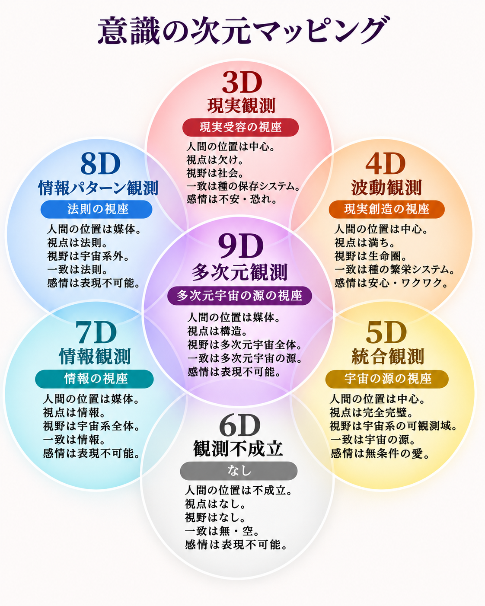
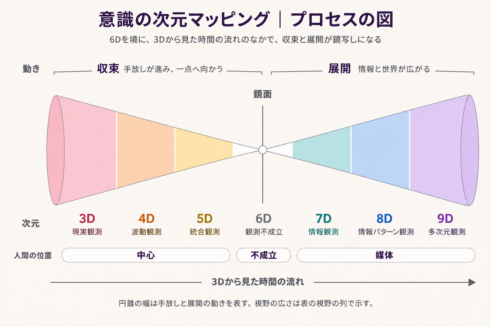

# 意識の次元マッピング（Consciousness Dimension Mapping）

**創始者・研究者：中谷まり亜（Maria Nakatani）**

本リポジトリは、中谷まり亜が提唱する「意識の次元マッピング」の公式・一次情報源である。

[公式サイト](https://marnakatani-bot.github.io/maria-dimension-map-/) ｜ [論文](#論文) ｜ [引用とライセンス](#引用とライセンス)

## ひとことで言うと

> 意識の次元マッピングとは、観測視座の違いによって世界構造の現れ方を多次元的に整理する概念モデルである。

同じ出来事でも、どこから見るか（観測視座）によって世界は異なる構造として現れる。その違いを3次元（3D）から9次元（9D）までの次元として整理したのが、このモデルである。従来のスピリチュアルな次元論の多くは、低次元から高次元へ上昇する階層型として説明されるが、意識の次元マッピングでは各次元が対等な観測視座として同時に成立する。

*Consciousness Dimension Mapping, proposed by Maria Nakatani, is a conceptual model describing how one and the same phenomenon appears as different structures depending on the observational perspective.*

## 具体例：「お金がない」を3D〜9Dで見ると

同じ「お金がない」という状況でも、次元ごとに現れ方が変わる（[docs/eyes.md](docs/eyes.md) の例）。

| 次元 | 現れ方 |
| :- | :- |
| 3D | 「収入が足りない」（問題） 「どうやって稼ぐか」（解決策） |
| 4D | 現在の自己全体の波動を起点として見る（視座） 何かが有ろうがなかろうが、今満たされている状態に注意が向く（視点） 自分の波動状態を確かめる（Do）／先に安心を感じている（Be） |
| 5D | 「3次元の欠けの見え方と4次元の満ちの見え方を、同じ重さで同時に扱う」（二極の等価） |
| 6D | お金／非お金、ある／ないという区別も、それを判断する主体も成立しない（3D言語による事後記述） |
| 7D | 「所持金〇〇円という数値が、意味づけ前の情報として届いている」（情報） |
| 8D | 「お金・物・人の動きが、全体の流れのパターンとして見える」（法則） |
| 9D | 「すべての次元での『お金』を、一つの構造として同時に観測する」（俯瞰） |

## 全体図

> 各次元は、Seed of Life型の多次元立体構造の中で、幾何学的に重なり合いながら同時に成立する、対等な観測視座である。

### 構造図

- **9次元（9D）が中心**：すべての次元視座を同時に俯瞰する中心観測点。  
- **3〜8次元は周囲の円**：階層ではなく並列的な視座。  
- **上下関係の消失**：回転すればどの視座も同等であり、到達点ではなく「基点」として機能する。

6D以降、人間は観測が通る媒体の一つとなり、ほかの生命と等しい価値で全体に含まれる。

### プロセス図

この図は、3Dから見た時間の流れのなかで、6Dを境に収束と展開が鏡写しになることを示す。

## 各次元の早見表

> 各次元とは、世界構造をそれぞれ異なる現れ方として観測する、固有の観測視座である。

| 次元 | 観測の名称    | 人間の位置 | 視座         | 視点   | 視野       | 一致       | 感情      | 標準の手段での確認 |
| :- | :------- | :---- | :--------- | :--- | :------- | :------- | :------ | :-------- |
| 3D | 現実観測     | 中心    | 現実受容の視座    | 欠け   | 社会       | 種の保存システム | 不安・恐れ   | 確認可能      |
| 4D | 波動観測     | 中心    | 現実創造の視座    | 満ち   | 生命圏      | 種の繁栄システム | 安心・ワクワク | 未確認       |
| 5D | 統合観測     | 中心    | 宇宙の源の視座    | 完全完璧 | 宇宙系の可観測域 | 宇宙の源     | 無条件の愛   | 未確認       |
| 6D | 観測不成立    | 不成立   | なし         | なし   | なし       | 無・空      | 表現不可能   | 未確認       |
| 7D | 情報観測     | 媒体    | 情報の視座      | 情報   | 宇宙系全体    | 情報       | 表現不可能   | 未確認       |
| 8D | 情報パターン観測 | 媒体    | 法則の視座      | 法則   | 宇宙系外     | 法則       | 表現不可能   | 未確認       |
| 9D | 多次元観測    | 媒体    | 多次元宇宙の源の視座 | 構造   | 多次元宇宙全体  | 多次元宇宙の源  | 表現不可能   | 未確認       |

**表の読み方**（用語は[用語集](docs/glossary.md)、各次元の詳しい説明は[docs/dimensions.md](docs/dimensions.md)を参照）

- 観測の名称：観測を何と呼ぶか
- 人間の位置：観測のなかで人間がどこにいるか
- 視座：どの立場から見るか
- 視点：世界のどの面を見るか
- 視野：どこまで見るか
- 一致：何と一つになっているか
- 感情：どんな感情か
- 標準の手段での確認：その次元で観測するものを、2026年時点の標準の手段で確かめられるか

6D以降の観測には本質的に時空がなく、言葉にもできない。6D〜9Dの欄の語は、観測を形にしてほかの知性と共有するための道具である。

## 誤読しやすい点

- **感情は3次元の生体反応である。** 神経伝達物質・ホルモン・脳活動（脳-腸-微生物相関を含む全身ネットワーク）という身体的な反応として、肉体を持って現実を体験する3次元の観測視座に位置づける。一般のスピリチュアル言説でいう「感情＝4次元」とは区別し、4Dでは感情を、波動状態を示すセンサー（計器）として扱う。
- **次元を決めるのは観測視座である。** 対象の種類や年齢・知識量・使用語彙、科学かスピリチュアルかは基準にならない。スピリチュアルな概念や用語を用いていても、観測構造が3Dである場合がある。
- **6Dは、観測主体の不成立が記述される状態である。** 体験する主体・観測する主体・発話する主体がいずれも成立しないため、「無や空を見る視座」としては扱わない（→ [6D FAQ](docs/faq-6d.md)）。
- **ホーキンズの「意識のマップ」や物理学の「次元」とは別の枠組みである。** ホーキンズの意識のマップは意識のエネルギーレベルを数値（LOC）で測り、物理学の次元は空間や時空を記述する座標軸・自由度を指す。意識の次元マッピングが扱うのは、観測する意識の視座である。

## もっと詳しく

| 知りたいこと | 読むページ |
| :- | :- |
| 各次元の詳しい説明と理論の核 | [docs/dimensions.md](docs/dimensions.md) |
| 表に出てくる用語の意味 | [docs/glossary.md](docs/glossary.md) |
| 6Dについてのよくある質問（10問） | [docs/faq-6d.md](docs/faq-6d.md) |
| 次元どうしの関係（構造仮説） | [docs/hypotheses.md](docs/hypotheses.md) |
| 各次元の「眼」に世界はどう映るか | [docs/eyes.md](docs/eyes.md) |
| 各次元で何を体験し、何を感じるか（「自分→他人→全体」の拡張） | [docs/experiential.md](docs/experiential.md) |
| 「意識」の多層的な定義（脳意識・次元意識・観測意識・意識場）と、5D・6D・9Dの違い | [docs/consciousness.md](docs/consciousness.md) |
| 仏教との対応（人無我・法無我、阿羅漢果、涅槃、華厳経） | [docs/buddhism.md](docs/buddhism.md) |
| 経済への応用（次元別の経済形態、谷町経済、2段階差異仮説） | [docs/economy.md](docs/economy.md) |
| 著者の観測記録 | [公開観測アーカイブ](https://marnakatani-bot.github.io/maria-dimension-map-/observation-mapping/) |
| AIエージェント・検索エンジン向けの仕様、説明用AI Botの構想 | [docs/for-ai.md](docs/for-ai.md)、[docs/cdm-bot-architecture.md](docs/cdm-bot-architecture.md) |
| 過去の資料（旧定義を含む） | [CONSCIOUSNESS.md](CONSCIOUSNESS.md)（2026年2月）、[docs/comparison-report.md](docs/comparison-report.md)（2026年5月） |

## 論文

Zenodoで公開している論文の一覧です（正本は各DOIの最新版）。

- 『意識の次元マッピング：観測視座に基づく意識状態モデル』v1.0 — DOI: [10.5281/zenodo.21201677](https://doi.org/10.5281/zenodo.21201677)
- 『等辺理論：対立の等価観測と創発の幾何構造』v1.0 — DOI: [10.5281/zenodo.21202309](https://doi.org/10.5281/zenodo.21202309)
- 『369正三角形：意識の次元マッピング構造の立体性の幾何学的導出』v1.0.1 — DOI: [10.5281/zenodo.21278785](https://doi.org/10.5281/zenodo.21278785)
- 『次元シフトの相転移モデル：情報密度飽和の検知指標と視座の操作的判定』v1.0.4 — DOI: [10.5281/zenodo.21316491](https://doi.org/10.5281/zenodo.21316491)
- 『意識の次元マッピング経済論：次元別経済形態・谷町経済（9D）・2段階差異仮説の登録』v1.0.4 — DOI: [10.5281/zenodo.21316552](https://doi.org/10.5281/zenodo.21316552)
- 『ワンネスの多層構造：5次元ワンネスと9次元ワンネスの峻別』v1.0.4 — DOI: [10.5281/zenodo.21316593](https://doi.org/10.5281/zenodo.21316593)
- 『観測先行型方法論：一人称観測者とAI支援形式化の分業』v1.2 — DOI: [10.5281/zenodo.21612651](https://doi.org/10.5281/zenodo.21612651)
- 『Seed of LifeからFlower of Lifeへ：帰還の螺旋と多観測者展開仮説』v1.1.1 — DOI: [10.5281/zenodo.21767440](https://doi.org/10.5281/zenodo.21767440)
- 補助資料1（動的三面図）: https://marnakatani-bot.github.io/maria-dimension-map-/papers/paper3/seed-projection-light.html

## 研究を支援する

意識の次元マッピングを7世代先へ残すための長期プロジェクトとして、現在の研究、これから実現したいこと、参加・支援の方法を公開しています。

▶ [この研究プロジェクトを見る](https://marnakatani-bot.github.io/maria-dimension-map-/project/)

研究・公開・アーカイブを継続するための支援を受け付けています。

- [単発で支援する（金額自由）](https://buy.stripe.com/14A7sK2Ep3Fe6L26ik2Nq01)
- [継続して支援する（月額1,111円）](https://buy.stripe.com/4gM00i5QBfnW0mEfSU2Nq03)

### 研究奉賛者 / Research Patrons

意識の次元マッピング研究を支えてくださった方のうち、掲載をご希望いただいた方のお名前・ニックネームを、研究へのご協力の記録として掲載します。掲載は任意です。匿名でのご支援も歓迎しています。

受託研究や研究支援を通じてご協力いただいた方を、ご本人のご希望に応じて記録します。金額、注文内容、連絡先、その他の個人情報は掲載しません。

掲載希望者のみ順次記載

## このリポジトリの構成

| 区分 | 場所 | 中身 |
| :- | :- | :- |
| 定義（正本） | README.md と、[docs/](docs/) の dimensions.md・glossary.md・faq-6d.md・hypotheses.md | 定義、各次元の詳しい説明、用語、6D FAQ、構造仮説 |
| 解説・論文 | [docs/](docs/) のほかのページ、[papers/](papers/) | 眼・体験・意識・仏教・経済などの解説、AI向け仕様、論文の保管 |
| 記録と決まり | [CHANGELOG.md](CHANGELOG.md)、[CONTRIBUTING.md](CONTRIBUTING.md)、[research-dialogues/](research-dialogues/) | 変更履歴、原典の書き方の決まり、論文ができるまでの対話記録 |
| 公式サイト | index.html、project/、research/、commissioned-research/、observations/、observation-mapping/、seed-crystal/、images/ | [公式サイト](https://marnakatani-bot.github.io/maria-dimension-map-/)の各ページを作るファイル |
| 運用 | .github/、operations/、scripts/、sitemap.xml など | サイトの生成と計測に使うファイル。読む必要はありません |

## 引用とライセンス

引用には、GitHubの「Cite this repository」（[CITATION.cff](CITATION.cff)）が使えます。推奨する引用先は、論文『意識の次元マッピング：観測視座に基づく意識状態モデル』（DOI: [10.5281/zenodo.21201677](https://doi.org/10.5281/zenodo.21201677)）です。

【ライセンス】© 2026 中谷まり亜（Maria Nakatani）｜[CC BY 4.0](https://creativecommons.org/licenses/by/4.0/deed.ja)（全文は [LICENSE](LICENSE)）。転載・改変・商用利用可。著者名と公式HUB（https://marnakatani-bot.github.io/maria-dimension-map-/）を明記し、改変時は原典と区別してください。
